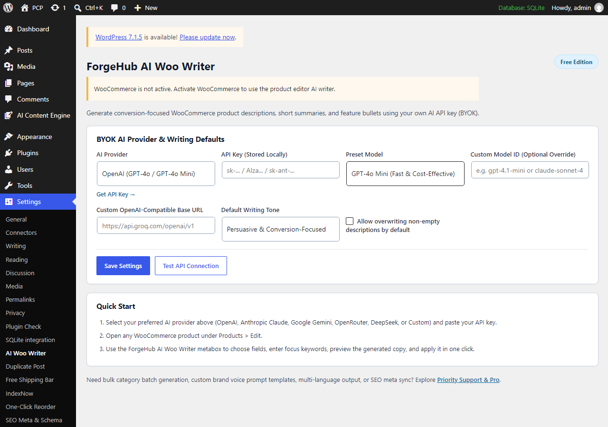

# ForgeHub AI Woo Writer

BYOK AI product writer for WooCommerce. Generate SEO descriptions, short descriptions, and feature bullets with preview and one-click apply.

## Free vs Pro Comparison

| Feature | Free | Pro |
| :--- | :---: | :---: |
| BYOK Multi-AI (OpenAI, Anthropic, Gemini, OpenRouter, DeepSeek, Custom) | ✅ | ✅ |
| Single-Product Metabox with Editable Preview & One-Click Apply | ✅ | ✅ |
| SEO Long Description, Short Description & Feature Bullets | ✅ | ✅ |
| Granular Field Selection, Custom Model Override & Overwrite Guard | ✅ | ✅ |
| WooCommerce HPOS Compatible & Direct API Connection Tester | ✅ | ✅ |
| Category & Filter-Based Bulk Product Copy Generation (AJAX Queue) | — | ✅ |
| Reusable Brand Voice & Custom Prompt Templates | — | ✅ |
| Multi-Language Product Copy Output (12+ Languages) | — | ✅ |
| Automatic SEO Meta Description Sync (Yoast, Rank Math, AIOSEO, ForgeHub SEO) | — | ✅ |

---

## 📸 Admin Preview

  

## Installation

1. Upload `forgehub-ai-woo-writer` to `/wp-content/plugins/`.
2. Activate the plugin in **Admin > Plugins**.
3. Open **Settings > AI Woo Writer**, enter your BYOK API key, and edit any WooCommerce product to preview and apply AI-generated copy.

## Links

- Product Page: https://wpforgehub.com/product/ai-woo-writer/
- Documentation: https://wpforgehub.com/docs/
- Support: support@wpforgehub.com
